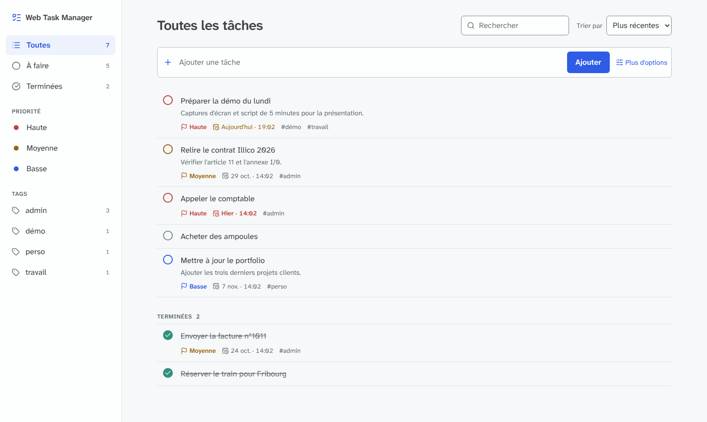
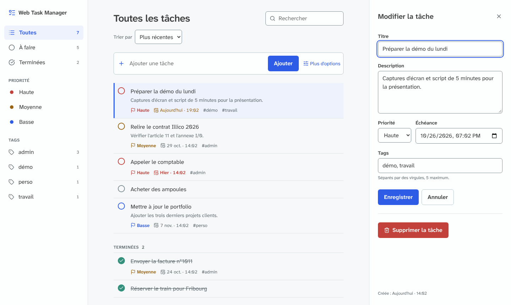

# Web Task Manager

Application web de gestion de tâches en Python : créer, modifier, supprimer et marquer des tâches comme terminées, avec recherche, filtres, priorités, tags, échéances et un serveur MCP pour piloter les tâches depuis un assistant IA.

Le suivi détaillé du développement est dans [DEVLOG.md](DEVLOG.md).



## Fonctionnalités

| Demandé | Réalisé |
|---|---|
| Afficher la liste des tâches | Liste triée, tâches terminées regroupées en bas avec un compteur |
| Ajouter une tâche (titre, description) | Ajout rapide en une ligne, ou formulaire complet dans un panneau |
| Modifier une tâche | Panneau latéral, sans quitter la liste |
| Supprimer une tâche | Boîte de confirmation avant suppression définitive |
| Marquer comme terminée / non terminée | Un clic sur le cercle à gauche de la tâche |

| Bonus | Réalisé |
|---|---|
| Filtres ou recherche | Recherche dans le titre et la description, filtres par priorité et par tag, filtres combinables et retirables un par un |
| Tri par statut | Vues Toutes / À faire / Terminées avec compteurs, tri par date, échéance, priorité ou titre |
| Responsive | Barre latérale en bandeau défilant et panneau plein écran sur mobile |
| Composants réutilisables | Macros Jinja2 : ligne de tâche, badges, champs de formulaire, icônes |
| Tags ou priorités | Les deux : priorité à 3 niveaux et jusqu'à 5 tags par tâche |
| MCP / intégration IA | Serveur MCP local : un assistant IA (Claude, Cursor…) peut lister, créer, modifier, terminer et supprimer des tâches |

En plus : échéance avec date et heure, affichée en orange à moins de 24 h et en rouge si elle est dépassée.

## Stack

| Couche | Choix |
|---|---|
| Langage | Python 3.12+ |
| Framework | Flask 3 |
| Base de données | SQLite (module `sqlite3` de Python, sans ORM) |
| Interface | HTML rendu par le serveur (Jinja2), CSS et JavaScript natifs |
| Validation | WTForms (via Flask-WTF) |
| Sécurité | Flask-WTF (CSRF), Flask-Limiter (limitation de débit), en-têtes HTTP stricts |
| IA | SDK MCP officiel (`mcp`) |
| Tests | pytest, pip-audit |

## Installation

Prérequis : Python 3.12 ou plus récent.

```bash
git clone https://github.com/Netxeo/Web-Task-Manager.git
cd Web-Task-Manager
python -m venv .venv
```

Activer l'environnement sous Windows :

```bash
.venv\Scripts\activate
```

Sous macOS ou Linux :

```bash
source .venv/bin/activate
```

Installer les dépendances et créer le fichier de configuration :

```bash
pip install -r requirements.txt
cp .env.example .env
python -c "import secrets; print(secrets.token_hex(32))"
```

Coller la valeur générée après `SECRET_KEY=` dans `.env`, puis lancer l'application :

```bash
flask --app app run
```

L'application est disponible sur http://127.0.0.1:5000. La base SQLite est créée automatiquement dans `instance/tasks.db`.

## Assistant IA (MCP)

Le MCP (Model Context Protocol) est un standard qui permet à un assistant IA d'utiliser les outils d'une application. Une fois branché, on peut écrire à l'assistant : « Ajoute une tâche : appeler le comptable demain à 10 h, priorité haute, tag admin ».

Le serveur tourne uniquement sur la machine de l'utilisateur et ne contient aucun compte ni aucune clé. Chaque personne le branche sur son propre assistant, et il lit et écrit dans la base de son installation.

1. Installer les dépendances IA :

   ```bash
   pip install -r requirements-ai.txt
   ```

2. Déclarer le serveur dans l'assistant. Avec Claude Code :

   ```bash
   claude mcp add web-task-manager -- /chemin/vers/Web-Task-Manager/.venv/bin/python /chemin/vers/Web-Task-Manager/mcp_server.py
   ```

   Avec Claude Desktop, dans le fichier `claude_desktop_config.json` :

   ```json
   {
     "mcpServers": {
       "web-task-manager": {
         "command": "C:\\chemin\\vers\\Web-Task-Manager\\.venv\\Scripts\\python.exe",
         "args": ["C:\\chemin\\vers\\Web-Task-Manager\\mcp_server.py"]
       }
     }
   }
   ```

3. Redémarrer l'assistant. Les tâches créées par l'IA apparaissent dans l'application web, et inversement.

| Outil | Rôle |
|---|---|
| `list_tasks` | Lister avec les mêmes filtres que le site (statut, recherche, tag, priorité, tri) |
| `get_task` | Afficher une tâche |
| `create_task` | Créer une tâche |
| `update_task` | Modifier uniquement les champs fournis |
| `set_task_done` | Marquer comme terminée ou à faire |
| `delete_task` | Supprimer (signalé comme destructif : l'assistant demande confirmation) |

## Tests

```bash
pip install -r requirements-dev.txt
pytest
pip-audit -r requirements-ai.txt
```

43 tests couvrent les fonctionnalités, la validation, les filtres, le serveur MCP et la sécurité.

## Architecture

```
app/
├── __init__.py          création de l'application
├── config.py            configuration lue depuis l'environnement
├── extensions.py        CSRF et limitation de débit
├── security.py          en-têtes HTTP de sécurité
├── errors.py            pages d'erreur
├── db.py                connexion SQLite
├── schema.sql           schéma de la base
├── tasks/
│   ├── routes.py        routes HTTP (contrôleur)
│   ├── repository.py    requêtes SQL sur les tâches (modèle)
│   ├── tags.py          règles et requêtes des tags
│   ├── forms.py         validation des saisies
│   ├── filters.py       lecture et contrôle des filtres d'URL
│   └── formatting.py    affichage des dates
├── ai/
│   ├── tools.py         actions disponibles pour l'IA
│   └── server.py        serveur MCP
├── templates/
│   ├── components/      composants réutilisables
│   ├── partials/        blocs de page
│   └── icons/           icônes Lucide
└── static/              CSS, JavaScript, polices
mcp_server.py            point d'entrée du serveur MCP
tests/                   tests automatisés
```

Organisation MVC : `repository.py` porte les requêtes SQL (modèle), `templates/` l'affichage (vue), `routes.py` les routes HTTP (contrôleur). Le serveur MCP réutilise exactement la même validation et le même accès aux données que le site : il n'existe pas de second chemin vers la base.

## Choix techniques

### Pourquoi SQLite

- Gratuit, sans compte, sans quota, inclus dans Python.
- Aucun serveur ni port réseau ouvert, aucun identifiant de base à protéger.
- Transactions ACID, tables en mode `STRICT` avec contraintes `CHECK` et clés étrangères : la base refuse elle-même les données invalides, même si une erreur passait la validation Python.
- Limite assumée : une seule écriture à la fois, parfait pour un usage individuel. L'accès aux données est isolé dans `repository.py` et `tags.py` pour pouvoir passer à PostgreSQL si besoin.

Les offres cloud gratuites (Supabase, Firebase…) ont été écartées : quotas, mise en pause des projets inactifs, compte obligatoire et données chez un tiers.

### Pourquoi Flask sans ORM

Flask rend les pages côté serveur avec un échappement automatique contre l'injection de scripts, et ses extensions de sécurité sont éprouvées. Le SQL est écrit à la main et toujours paramétré, pour garder le contrôle et la lisibilité des requêtes.

### Sécurité

| Risque | Protection |
|---|---|
| Injection SQL | Requêtes paramétrées uniquement. Le tri passe par une liste fermée, aucune saisie n'entre dans le texte SQL. Les `%` et `_` de la recherche sont échappés. |
| Injection de script (XSS) | Échappement automatique Jinja2, CSP sans script inline, JavaScript qui n'utilise que `textContent`. |
| Requête forgée depuis un autre site (CSRF) | Jeton sur chaque formulaire, cookie `SameSite=Lax`, aucune modification en GET. |
| Saisies malveillantes | Validation serveur : longueurs, liste de priorités, format de date, tags limités en nombre et en caractères, caractères de contrôle supprimés. Requêtes limitées à 16 Ko. |
| Abus | 60 écritures par minute et 300 requêtes par minute par adresse IP. |
| Redirection ouverte | Après une action, la page de retour est reconstruite à partir des filtres validés, jamais d'une URL reçue. |
| Clickjacking, fuites | `frame-ancestors 'none'`, `X-Frame-Options`, `nosniff`, `Referrer-Policy`, pages d'erreur sans détail technique. |
| Secrets | Clé secrète lue dans l'environnement, refus de démarrer si elle est absente ou faible. `.env` ignoré par Git. |
| Ressources tierces | Polices et icônes hébergées dans le projet : aucune requête vers un service externe. |
| IA | Serveur MCP local sans port réseau, même validation que le site, suppression marquée comme destructive, consigne de traiter le contenu des tâches comme des données et non comme des instructions. |
| Dépendances | Versions épinglées, `pip-audit` sans vulnérabilité connue. |

### Interface

- Conventions des gestionnaires de tâches connus : barre latérale, ajout rapide, cercle de complétion, panneau de modification à droite.
- Palette issue d'Adobe Color, contrastes vérifiés au niveau WCAG AA.
- Tout fonctionne sans JavaScript ; le JavaScript ajoute la confirmation de suppression, le tri automatique et la touche Échap.
- Accessibilité : zones cliquables de 44 px, focus visible, libellés sur tous les champs, lien d'évitement, état « terminé » signalé par une coche et pas seulement par la couleur.




## Typographie

Atkinson Hyperlegible Next et Atkinson Hyperlegible Mono (Braille Institute), choisies pour leur lisibilité : chaque caractère facile à confondre (I, l, 1, O, 0) a une forme distincte. Fichiers hébergés dans `app/static/fonts`, sous licence SIL Open Font License 1.1. Icônes [Lucide](https://lucide.dev), licence ISC.

## Limites connues

- Pas de comptes utilisateurs : l'application est mono-utilisateur et prévue pour tourner en local. Une mise en ligne demanderait une authentification et HTTPS (`SESSION_COOKIE_SECURE=1`).
- `flask run` est un serveur de développement ; en production il faudrait un serveur WSGI comme Gunicorn ou Waitress.
- La limitation de débit est stockée en mémoire et repart de zéro au redémarrage.

## Licence

Code source disponible sous [PolyForm Noncommercial 1.0.0](LICENSE).

- Consultation, étude et modification autorisées à des fins non commerciales.
- Toute utilisation commerciale est interdite.
- Le crédit de l'auteur est obligatoire : la ligne `Required Notice` du fichier `LICENSE` doit être conservée dans toute copie ou redistribution.

© 2026 Paul Noorman, [Netxeo](https://github.com/Netxeo)
