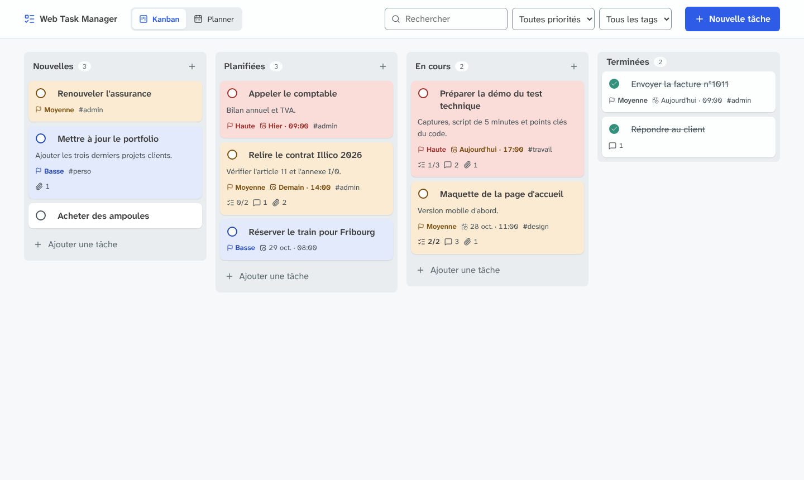
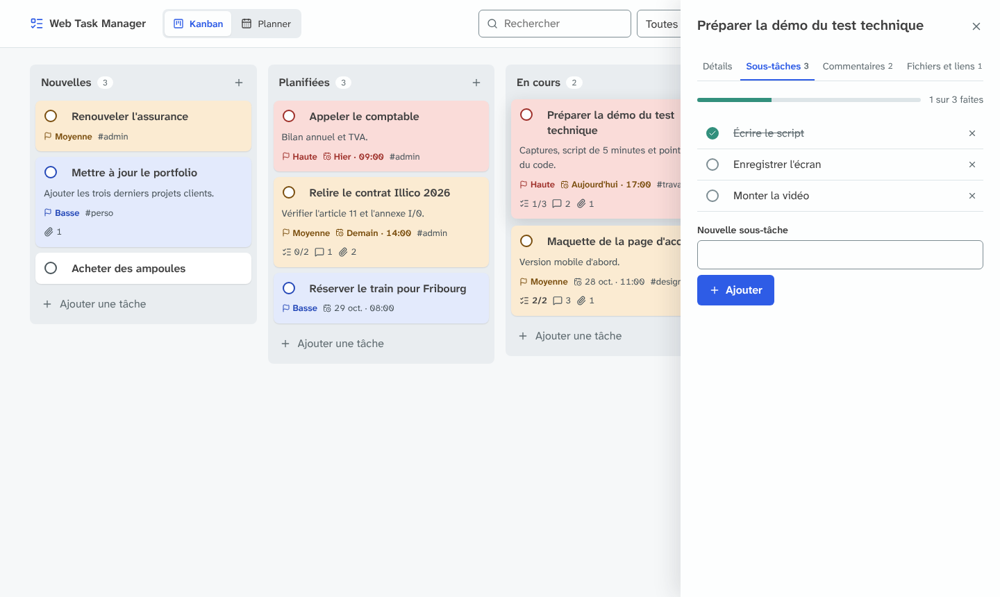
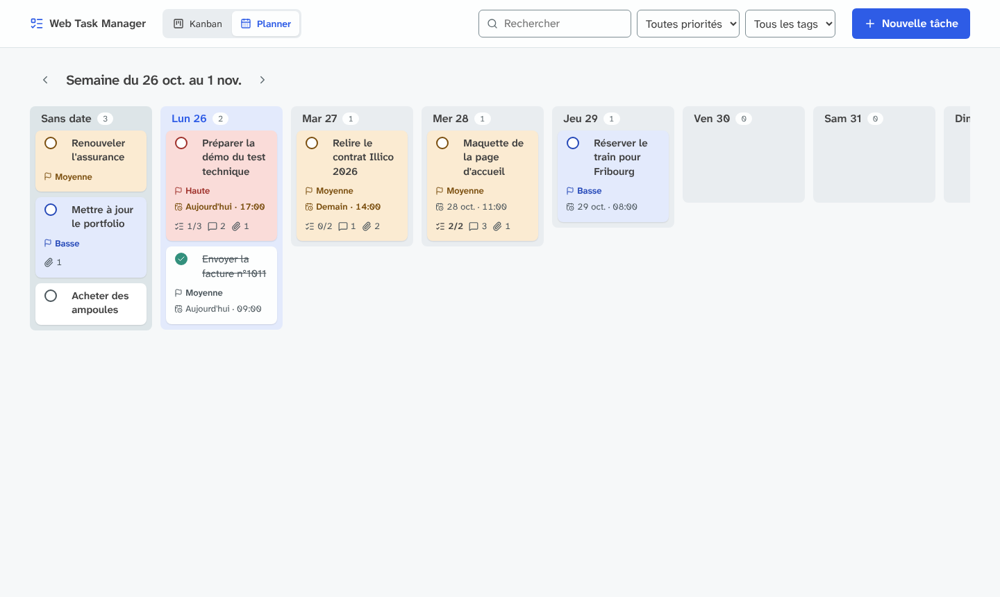
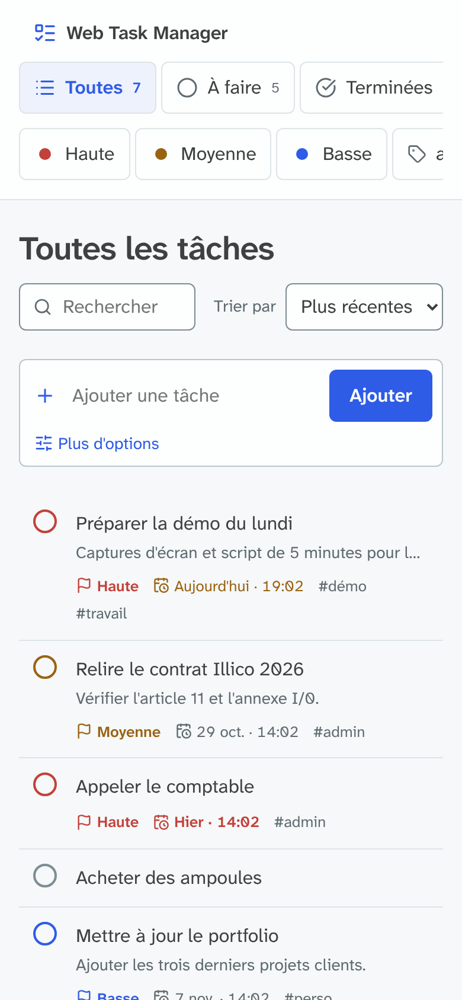

# Web Task Manager

Application web de gestion de tâches en Python, organisée en tableau Kanban et en planner semaine : créer, modifier, supprimer et terminer des tâches, les glisser de colonne en colonne, les découper en sous-tâches, les commenter, y joindre des fichiers et des liens, et les piloter depuis un assistant IA grâce à un serveur MCP.

Le suivi détaillé du développement est dans [DEVLOG.md](DEVLOG.md).



## Fonctionnalités

| Demandé | Réalisé |
|---|---|
| Afficher la liste des tâches | Tableau Kanban en 4 colonnes (Nouvelles, Planifiées, En cours, Terminées), cartes classées par priorité, et planner semaine |
| Ajouter une tâche (titre, description) | Ajout rapide en bas de chaque colonne, ou formulaire complet dans un panneau |
| Modifier une tâche | Fiche latérale à onglets : Détails, Sous-tâches, Commentaires, Fichiers et liens |
| Supprimer une tâche | Boîte de confirmation, puis suppression de la tâche et de tout son contenu |
| Marquer comme terminée / non terminée | Un clic sur le cercle de la carte, ou glisser la carte dans « Terminées » |

| Bonus | Réalisé |
|---|---|
| Filtres ou recherche | Recherche dans le titre et la description, filtres par priorité et par tag, filtres combinables et retirables un par un |
| Tri par statut | Une colonne par statut avec compteur ; dans chaque colonne, tri automatique Haute, Moyenne, Basse, Aucune |
| Responsive | Colonnes qui défilent horizontalement avec aimantation, fiche en plein écran sur mobile |
| Composants réutilisables | Macros Jinja2 : carte de tâche, badges, champs de formulaire, icônes ; la même carte sert au Kanban et au planner |
| Tags ou priorités | Les deux : priorité à 3 niveaux (couleur de la carte) et jusqu'à 5 tags par tâche |
| MCP / intégration IA | Serveur MCP local : un assistant IA (Claude, Cursor…) peut lister, créer, modifier, déplacer, commenter et supprimer des tâches |

En plus :
- **Glisser-déposer** entre colonnes (SortableJS, compatible tactile) et sur les jours du planner pour changer la date.
- **Sous-tâches** avec barre de progression et compteur « 2/4 » sur la carte.
- **Commentaires** datés, **liens utiles** et **fichiers joints** (PDF, PNG, JPG).
- **Échéance** avec date et heure, en orange à moins de 24 h et en rouge si elle est dépassée.

## Stack

| Couche | Choix |
|---|---|
| Langage | Python 3.12+ |
| Framework | Flask 3 |
| Base de données | SQLite (module `sqlite3` de Python, sans ORM) |
| Interface | HTML rendu par le serveur (Jinja2), CSS et JavaScript natifs, SortableJS pour le glisser-déposer |
| Validation | WTForms (via Flask-WTF) |
| Sécurité | Flask-WTF (CSRF), Flask-Limiter (limitation de débit), Pillow (nettoyage des images), en-têtes HTTP stricts |
| IA | SDK MCP officiel (`mcp`) |
| Tests et qualité | pytest, pip-audit, ruff (style et erreurs) |

## Installation

Prérequis : Python 3.12 ou plus récent.

```bash
git clone https://github.com/Netxeo/Web-Task-Manager.git
cd Web-Task-Manager
python -m venv .venv
```

Activer l'environnement sous Windows :

```bash
.venv\Scripts\activate
```

Sous macOS ou Linux :

```bash
source .venv/bin/activate
```

Installer les dépendances et créer le fichier de configuration :

```bash
pip install -r requirements.txt
cp .env.example .env
python -c "import secrets; print(secrets.token_hex(32))"
```

Coller la valeur générée après `SECRET_KEY=` dans `.env`, puis lancer l'application :

```bash
flask --app app run
```

L'application est disponible sur http://127.0.0.1:5000. La base SQLite est créée automatiquement dans `instance/tasks.db`.

## Assistant IA (MCP)

Le MCP (Model Context Protocol) est un standard qui permet à un assistant IA d'utiliser les outils d'une application. Une fois branché, on peut écrire à l'assistant : « Ajoute une tâche : appeler le comptable demain à 10 h, priorité haute, tag admin ».

Le serveur tourne uniquement sur la machine de l'utilisateur et ne contient aucun compte ni aucune clé. Chaque personne le branche sur son propre assistant, et il lit et écrit dans la base de son installation.

1. Installer les dépendances IA :

   ```bash
   pip install -r requirements-ai.txt
   ```

2. Déclarer le serveur dans l'assistant. Avec Claude Code :

   ```bash
   claude mcp add web-task-manager -- /chemin/vers/Web-Task-Manager/.venv/bin/python /chemin/vers/Web-Task-Manager/mcp_server.py
   ```

   Avec Claude Desktop, dans le fichier `claude_desktop_config.json` :

   ```json
   {
     "mcpServers": {
       "web-task-manager": {
         "command": "C:\\chemin\\vers\\Web-Task-Manager\\.venv\\Scripts\\python.exe",
         "args": ["C:\\chemin\\vers\\Web-Task-Manager\\mcp_server.py"]
       }
     }
   }
   ```

3. Redémarrer l'assistant. Les tâches créées par l'IA apparaissent dans l'application web, et inversement.

Pour que l'assistant puisse seulement consulter les tâches sans rien modifier, ajouter `MCP_READ_ONLY=1` dans le fichier `.env` : seuls `list_tasks` et `get_task` restent disponibles.

| Outil | Rôle |
|---|---|
| `list_tasks` | Lister une colonne ou tout le tableau, avec les mêmes filtres que le site |
| `get_task` | Afficher une tâche avec ses sous-tâches, commentaires et liens |
| `create_task` | Créer une tâche dans la colonne voulue |
| `update_task` | Modifier uniquement les champs fournis |
| `move_task` | Déplacer une tâche dans une autre colonne |
| `add_subtask` | Ajouter une sous-tâche |
| `add_comment` | Ajouter un commentaire |
| `delete_task` | Supprimer (signalé comme destructif : l'assistant demande confirmation) |

## Tests

```bash
pip install -r requirements-dev.txt
ruff check .
ruff format --check .
pytest
pip-audit -r requirements-ai.txt
```

99 tests couvrent les fonctionnalités, le Kanban et le planner, la validation, les sous-tâches, commentaires et liens, les fichiers joints, le serveur MCP et la sécurité.

## Architecture

```
app/
├── __init__.py            création de l'application
├── core/
│   ├── config.py          configuration lue depuis l'environnement
│   ├── db.py              connexion SQLite et dossier des fichiers joints
│   ├── schema.sql         schéma de la base
│   ├── extensions.py      CSRF et limitation de débit
│   ├── security.py        en-têtes HTTP, origine et taille des requêtes
│   ├── converters.py      identifiants acceptés dans les adresses
│   └── errors.py          pages d'erreur
├── tasks/
│   ├── data/              requêtes SQL (modèle) : tâches, tags, sous-tâches, commentaires, liens, fichiers
│   ├── routes/            routes HTTP (contrôleur) : tableau, tâches, détails, fichiers
│   ├── forms.py           validation de la tâche
│   ├── detail_forms.py    validation des sous-tâches, commentaires, liens et fichiers
│   ├── uploads.py         contrôle et stockage des fichiers joints
│   ├── sanitize.py        nettoyage des images
│   ├── pdf_check.py       inspection des PDF, flux compressés compris
│   ├── removal.py         suppression d'une tâche et de ses fichiers
│   ├── filters.py         colonnes, vues et filtres autorisés
│   ├── moments.py         calcul des semaines du planner
│   └── formatting.py      affichage des dates et tailles
├── ai/
│   ├── tools.py           actions disponibles pour l'IA
│   └── server.py          serveur MCP
├── templates/
│   ├── components/        composants réutilisables (carte, badges, champs, icônes)
│   ├── partials/          blocs de page (barre du haut, Kanban, planner, fiche à onglets)
│   └── icons/             icônes Lucide
└── static/
    ├── css/               base/ (polices, variables, socle), layout/ (structure), components/ (blocs)
    ├── js/                glisser-déposer, onglets, confirmation, filtres automatiques
    ├── vendor/            SortableJS
    └── fonts/             polices Atkinson Hyperlegible
.github/                   tests automatiques et Dependabot
licenses/                  licences des polices, icônes et bibliothèques tierces
mcp_server.py              point d'entrée du serveur MCP
tests/                     tests rangés comme le code : core/, tasks/, security/, ai/
```

Organisation MVC : `tasks/data/` porte les requêtes SQL (modèle), `templates/` l'affichage (vue), `tasks/routes/` les routes HTTP (contrôleur). Le serveur MCP réutilise exactement la même validation et le même accès aux données que le site : il n'existe pas de second chemin vers la base.

## Choix techniques

### Pourquoi SQLite

- Gratuit, sans compte, sans quota, inclus dans Python.
- Aucun serveur ni port réseau ouvert, aucun identifiant de base à protéger.
- Transactions ACID, tables en mode `STRICT` avec contraintes `CHECK` et clés étrangères : la base refuse elle-même les données invalides, même si une erreur passait la validation Python.
- Limite assumée : une seule écriture à la fois, parfait pour un usage individuel. L'accès aux données est isolé dans `tasks/data/` pour pouvoir passer à PostgreSQL si besoin.

Les offres cloud gratuites (Supabase, Firebase…) ont été écartées : quotas, mise en pause des projets inactifs, compte obligatoire et données chez un tiers.

### Pourquoi Flask sans ORM

Flask rend les pages côté serveur avec un échappement automatique contre l'injection de scripts, et ses extensions de sécurité sont éprouvées. Le SQL est écrit à la main et toujours paramétré, pour garder le contrôle et la lisibilité des requêtes.

### Sécurité

| Risque | Protection |
|---|---|
| Injection SQL | Toutes les requêtes sont écrites en entier dans le code, avec des paramètres nommés : aucun texte SQL n'est assemblé à l'exécution, même pour les filtres facultatifs. Les `%` et `_` de la recherche sont échappés. `bandit` ne signale rien. |
| Injection de script (XSS) | Échappement automatique Jinja2, CSP sans script inline, aucun `innerHTML` dans le JavaScript : les textes passent par `textContent` et le rafraîchissement du tableau réutilise le HTML déjà échappé par le serveur. |
| Requête forgée depuis un autre site (CSRF) | Trois barrières : jeton sur chaque formulaire, cookie `SameSite=Strict`, et refus (403) de toute écriture que le navigateur signale comme venant d'un autre site (`Sec-Fetch-Site`), y compris d'une autre application sur `localhost`. Aucune modification en GET. |
| Saisies malveillantes | Validation serveur : longueurs, listes de colonnes et de priorités, format de date, tags limités en nombre et en caractères, caractères de contrôle et caractères invisibles d'inversion de texte supprimés (anti-usurpation du type « facture\u202Efdp.exe »), texte normalisé en Unicode NFC, tags en NFKC pour éviter les doublons trompeurs. Requêtes limitées à 16 Ko hors envoi de fichier. Nombre de sous-tâches, commentaires, liens et fichiers plafonné par tâche. |
| Fichiers joints | PDF, PNG et JPG uniquement, 5 Mo maximum. Le contenu réel est vérifié, pas seulement l'extension. Les images sont entièrement décodées puis réenregistrées avec Pillow : un faux PNG est refusé, et les métadonnées (position GPS, modèle d'appareil) sont supprimées, l'orientation est conservée. Les PDF sont inspectés en profondeur sans antivirus : les flux d'objets compressés sont décompressés (avec un plafond contre les bombes de décompression) et analysés, les noms camouflés sont décodés, et tout PDF contenant du JavaScript, des actions de lancement ou des fichiers cachés est refusé. Un PDF chiffré ou compressé d'une façon qui empêche la vérification est refusé plutôt qu'accepté à l'aveugle. Testé sans faux positif sur 521 PDF réels, dont 100 avec flux compressés. Protection contre les images géantes (40 millions de pixels maximum). Stockage hors du dossier public sous un nom aléatoire, nom d'origine nettoyé. Téléchargement forcé (`Content-Disposition: attachment`) avec une CSP `sandbox` : un fichier ne peut jamais s'exécuter dans le site. SVG et HTML refusés. |
| Liens | Seuls `http://` et `https://` sont acceptés (pas de `javascript:` ni de `data:`), sans identifiants dans l'adresse. Ouverture dans un nouvel onglet avec `rel="noopener noreferrer nofollow"`. Le vrai domaine est affiché à côté du titre, en Punycode pour les noms internationaux : un lien intitulé « apple.com » qui pointe ailleurs, ou un domaine qui imite un autre avec des lettres cyrilliques, se voit tout de suite. L'application ne visite jamais les liens (pas de risque SSRF). |
| Accès croisé | Chaque sous-tâche, commentaire, lien ou fichier n'est accessible qu'à travers sa propre tâche. |
| Abus | 60 écritures par minute, 10 envois de fichiers par minute et 300 requêtes par minute par adresse IP. |
| Redirection ouverte | Après une action, la page de retour est reconstruite à partir des filtres validés, jamais d'une URL reçue. |
| Clickjacking, fuites | `frame-ancestors 'none'`, `X-Frame-Options`, `nosniff`, `Referrer-Policy`, isolation `COOP`, `COEP` et `CORP`, pages jamais mises en cache (`Cache-Control: no-store`), pages d'erreur sans détail technique. |
| Injection de HTML par le navigateur | Trusted Types activés dans la CSP : le navigateur refuse toute insertion de HTML qui ne passe pas par l'unique point autorisé du code. |
| Secrets | Clé secrète lue dans l'environnement, refus de démarrer si elle est absente ou faible. `.env` ignoré par Git. |
| Ressources tierces | Polices, icônes et SortableJS hébergés dans le projet : aucune requête vers un service externe. |
| IA | Serveur MCP local sans port réseau, même validation que le site, suppression marquée comme destructive, consigne de traiter le contenu des tâches comme des données et non comme des instructions. Mode lecture seule (`MCP_READ_ONLY=1`) pour n'autoriser que la consultation. |
| Dépendances | Toutes les versions épinglées, y compris les dépendances indirectes. `pip-audit` sans vulnérabilité connue, vérifié à chaque push par GitHub Actions (permissions minimales, actions épinglées par empreinte). Dependabot propose les mises à jour chaque semaine. |

### Interface

Inspirée de Bordio et Trello, et appuyée sur la recherche en psychologie des listes de tâches :

- **Kanban en colonnes verticales** : l'état de chaque tâche se lit d'un coup d'œil, et la déplacer est un geste direct.
- **Tri automatique par priorité** dans chaque colonne : l'important est toujours en haut, aucune décision de tri à prendre (loi de Hick).
- **Couleur unie par priorité** sur chaque carte, avec des contrastes de texte de 5:1 minimum : la couleur porte un sens, jamais une décoration.
- **Planner semaine** : glisser une carte sur un jour lui donne sa date ; la colonne « Sans date » joue le rôle de file d'attente.
- **Sous-tâches avec progression** : chaque étape cochée fait avancer la barre ; montrer la progression motive à terminer (gradient d'objectif, Kivetz et al., 2006).
- **Tout dans une seule interface** : priorité, date, tags et compteurs sont sur la carte, la fiche s'ouvre à côté du tableau sans changer de page.
- **Rouge réservé au retard** : quand tout est urgent, plus rien ne l'est (fatigue d'alerte).
- Tout fonctionne sans JavaScript (la colonne se change dans la fiche) ; le JavaScript ajoute le glisser-déposer, les onglets instantanés, la confirmation de suppression et la touche Échap.
- Accessibilité : zones cliquables de 44 px, focus visible, libellés sur tous les champs, onglets navigables au clavier, état « terminé » signalé par une coche et pas seulement par la couleur.







## Typographie

Atkinson Hyperlegible Next et Atkinson Hyperlegible Mono (Braille Institute), choisies pour leur lisibilité : chaque caractère facile à confondre (I, l, 1, O, 0) a une forme distincte. Fichiers hébergés dans `app/static/fonts`, sous licence SIL Open Font License 1.1. Icônes [Lucide](https://lucide.dev), licence ISC. Glisser-déposer [SortableJS](https://github.com/SortableJS/Sortable), licence MIT. Les textes des licences sont dans `licenses/`.

## Limites connues

- Pas de comptes utilisateurs : l'application est mono-utilisateur et prévue pour tourner en local. Une mise en ligne demanderait une authentification et HTTPS (`SESSION_COOKIE_SECURE=1`).
- `flask run` est un serveur de développement ; en production il faudrait un serveur WSGI comme Gunicorn ou Waitress.
- La limitation de débit est stockée en mémoire et repart de zéro au redémarrage.
- Les refus de sécurité (403, 413, 429, fichiers rejetés) ne sont pas enregistrés dans un journal : utile seulement pour une version en ligne.
- Les commentaires n'ont pas d'auteur, puisqu'il n'y a pas de comptes : ce sont des notes datées.
- Le glisser-déposer ne se fait pas au clavier ; au clavier, la colonne et la date se changent dans la fiche de la tâche.
- Si une base créée par une version précédente du projet est détectée, l'application s'arrête avec un message clair : il suffit de supprimer `instance/tasks.db`.

## Licence

Code source disponible sous [PolyForm Noncommercial 1.0.0](LICENSE).

- Consultation, étude et modification autorisées à des fins non commerciales.
- Toute utilisation commerciale est interdite.
- Le crédit de l'auteur est obligatoire : la ligne `Required Notice` du fichier `LICENSE` doit être conservée dans toute copie ou redistribution.

© 2026 Paul Noorman, [Netxeo](https://github.com/Netxeo)
